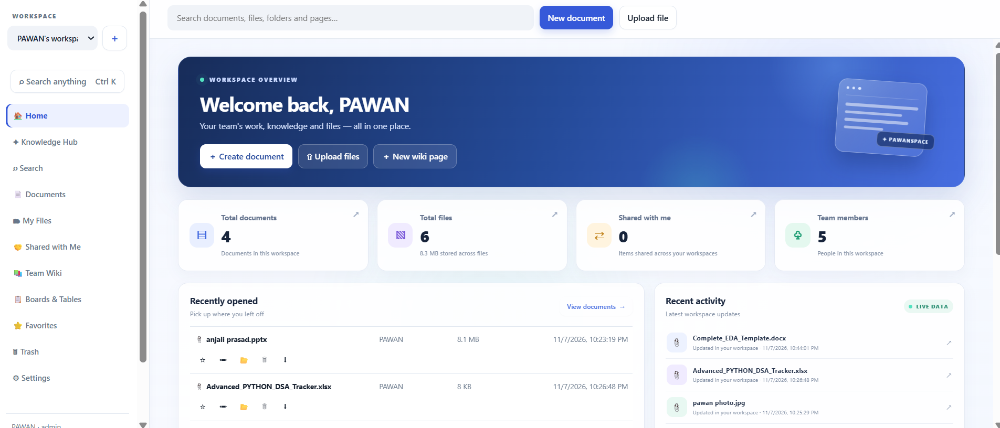

# PAWANSPACE

### A Collaborative Team Workspace & Document Management Platform

PAWANSPACE is a web-based workspace designed to help teams organize work, create and manage documents, share files, and collaborate in real time. It combines a FastAPI application with a lightweight web interface and a separate Yjs/Hocuspocus collaboration service.

> **Project status:** Development project. Review the configuration and deployment notes before exposing the application to the public internet.

---

## Dashboard Preview



*Add the dashboard screenshot at `docs/screenshots/dashboard.png` to display it here on GitHub.*

---

## Overview

PAWANSPACE brings essential team workspace and document-management capabilities into one application:

- A centralized workspace dashboard.
- Document creation and organization.
- File upload and management.
- Document sharing and role-based access.
- Real-time collaborative editing powered by Yjs and Hocuspocus.
- User authentication and session-based access.
- Export support through the application.

The application is composed of two services:

| Service | Technology | Local address | Responsibility |
|---|---|---|---|
| Web application / API | FastAPI, Python, SQLite | `http://localhost:8000` | Authentication, workspace and document APIs, file operations, and serving the web interface |
| Collaboration server | Node.js, Hocuspocus, Yjs | `ws://127.0.0.1:1234` | Real-time collaborative document updates and CRDT persistence |

The collaboration service communicates with the FastAPI application to validate collaboration tickets and access.

---

## Key Capabilities

### Workspace and documents
- Workspace dashboard and document navigation.
- Create and manage documents.
- Rename, duplicate, move, and delete documents where enabled by the application.
- Restore support where available in the application interface.

### File management
- Upload and manage workspace files.
- Preview, download, and delete supported files.
- File upload size is configurable through `MAX_UPLOAD_MB`.

### Collaboration
- Real-time document synchronization using **Yjs CRDT**.
- Hocuspocus WebSocket collaboration server.
- Tiptap-based collaborative editor components.
- Persistent collaboration data stored separately from the main application database.

### Access and security
- Authenticated API access.
- Document/workspace roles such as administrator, editor, and viewer, as implemented by the application.
- Signed collaboration tickets validated by the collaboration service.
- Environment-based configuration for secrets and service URLs.

### Export
- Document export functionality provided by the application.
- Hindi PDF font configuration can be supplied through `FONT_PATH` when required.

> Feature availability depends on the current application configuration and implementation. This README describes the project structure and configured capabilities; it is not a third-party security or production-readiness certification.

---

## Technology Stack

**Backend**
- Python
- FastAPI
- SQLite
- Uvicorn

**Frontend**
- HTML
- CSS
- JavaScript

**Real-time collaboration**
- Node.js
- Hocuspocus
- Yjs
- Tiptap
- Vite

**Development and deployment support**
- Git
- npm
- Docker-related configuration files

---

## Project Structure

```text
PAWANSPACE/
├── collaboration/
│   ├── frontend/
│   │   └── crdt.js
│   ├── hocuspocus-server.mjs
│   ├── package.json
│   ├── package-lock.json
│   └── vite.config.mjs
├── docs/
│   └── screenshots/
│       └── dashboard.png
├── static/
│   ├── assets/
│   │   └── crdt/
│   │       └── crdt.js
│   └── index.html
├── tests/
│   └── test_smoke.py
├── .dockerignore
├── .env.example
├── .gitignore
├── Caddyfile
├── DEPLOY.md
├── Dockerfile
├── docker-compose.yml
├── export.py
├── main.py
├── requirements.txt
├── run.bat
└── run.sh
```

Runtime databases, uploaded user data, virtual environments, dependency folders, and secrets should remain outside version control.

---

## Requirements

Install the following before running PAWANSPACE:

- Python 3.10 or newer (use a version compatible with the pinned packages in `requirements.txt`).
- Node.js and npm.
- Git.
- A modern web browser.

The collaboration service uses native Node dependencies such as `better-sqlite3`; on some systems, its installation may require build tools.

---

## Local Setup

### 1. Clone the repository

```bash
git clone https://github.com/PAWAN0207/PAWANSPACE.git
cd PAWANSPACE
```

### 2. Create and activate a Python virtual environment

**Windows PowerShell**
```powershell
python -m venv .venv
.\.venv\Scripts\Activate.ps1
```

If PowerShell blocks activation, you can use:
```powershell
.\.venv\Scripts\python.exe -m pip install -r requirements.txt
```

**macOS / Linux**
```bash
python3 -m venv .venv
source .venv/bin/activate
```

### 3. Install Python dependencies

```bash
python -m pip install --upgrade pip
python -m pip install -r requirements.txt
```

### 4. Configure environment variables

Copy the example file:

**Windows PowerShell**
```powershell
Copy-Item .env.example .env
```

**macOS / Linux**
```bash
cp .env.example .env
```

Generate a strong collaboration secret:

```bash
python -c "import secrets; print(secrets.token_hex(32))"
```

Put the generated 64-character hexadecimal value in your local `.env` file. Do not commit `.env` or share the secret.

Set or verify these collaboration settings in `.env`:

```dotenv
APP_URL=http://localhost:8000

COLLAB_TICKET_SECRET=PASTE_YOUR_64_CHARACTER_HEX_SECRET_HERE
COLLAB_TICKET_TTL_SECONDS=90
COLLAB_WS_URL=ws://127.0.0.1:1234
COLLAB_API_URL=http://127.0.0.1:8000
```

Other optional settings:

```dotenv
TOKEN_DAYS=7
MAX_UPLOAD_MB=50

# Optional email invitations (configure your SMTP provider)
# SMTP_HOST=
# SMTP_PORT=587
# SMTP_USER=
# SMTP_PASS=
# SMTP_FROM=

# Optional Unicode font path for Hindi PDF output
# FONT_PATH=
```

Use the same `COLLAB_TICKET_SECRET` for the FastAPI application and collaboration server. Keep it private.

### 5. Install and build the collaboration frontend

Open a terminal in the collaboration directory:

```bash
cd collaboration
npm ci
npm run build
```

The Vite build writes the collaboration frontend bundle to:

```text
static/assets/crdt/crdt.js
```

Return to the project root before starting the application:

```bash
cd ..
```

### 6. Start the FastAPI application

In **Terminal 1**, from the project root:

```bash
python -m uvicorn main:app --host 127.0.0.1 --port 8000
```

Open:

```text
http://localhost:8000
```

### 7. Start the collaboration server

In **Terminal 2**, from the project root:

```bash
cd collaboration
node hocuspocus-server.mjs
```

The collaboration WebSocket server listens on:

```text
ws://127.0.0.1:1234
```

Keep both services running while using real-time collaboration. Starting only the FastAPI service does not start the separate Hocuspocus server.

---

## Running on Windows

The repository includes `run.bat` and `run.sh` helper scripts for starting the FastAPI application. The collaboration server is a separate process.

For a complete local setup:

1. Install Python dependencies.
2. Configure `.env`.
3. Install Node dependencies and build the collaboration frontend.
4. Start FastAPI.
5. Start Hocuspocus in a second terminal.

See **Local Setup** above for the commands.

---

## Configuration Reference

| Variable | Purpose | Default / example |
|---|---|---|
| `APP_URL` | Base URL of the FastAPI application | `http://localhost:8000` |
| `TOKEN_DAYS` | Authentication token lifetime in days | `7` |
| `MAX_UPLOAD_MB` | Maximum upload size in MB | `50` |
| `COLLAB_TICKET_SECRET` | Shared secret used to sign and validate collaboration tickets | Generate a private 64-character hex value |
| `COLLAB_TICKET_TTL_SECONDS` | Collaboration ticket lifetime | `90` |
| `COLLAB_WS_URL` | Browser-facing collaboration WebSocket URL | `ws://127.0.0.1:1234` |
| `COLLAB_API_URL` | FastAPI URL used by the collaboration service | `http://127.0.0.1:8000` |
| `SMTP_HOST` | SMTP server for invitation emails | Optional |
| `SMTP_PORT` | SMTP server port | `587` |
| `SMTP_USER` | SMTP username | Optional |
| `SMTP_PASS` | SMTP password or app password | Optional |
| `SMTP_FROM` | Sender email address | Optional |
| `FONT_PATH` | Unicode font path for PDF output | Optional |

For a hosted deployment, replace local URLs with the correct public application and secure WebSocket URLs, and configure the reverse proxy and network access accordingly.

---

## Data and Persistence

The application stores runtime data separately from source code:

- Main application database: `data/app.db`
- Uploaded files: `data/files/`
- Collaboration database: `collaboration/data/crdt.sqlite`

These paths contain runtime or user data and should not be committed to Git. Back them up securely before performing maintenance or upgrades.

---

## Tests

A smoke test is included in the `tests/` directory.

Run the test suite with:

```bash
python -m pytest
```

The test result depends on the local environment and configuration. Run the tests after installing dependencies and configuring the application.

---

## Security Notes

- Never commit `.env`, API keys, passwords, SMTP credentials, or collaboration secrets.
- Use a unique, strong `COLLAB_TICKET_SECRET`.
- Keep runtime databases, uploaded files, and backups out of the public repository.
- Use HTTPS and secure WebSockets (`wss://`) for public deployments.
- Do not expose development servers directly to the public internet.
- Configure production database backups, logging, access controls, and reverse-proxy rules before deployment.
- Review the Docker and reverse-proxy configuration before relying on it for a production deployment; the local two-service setup described above is the reference development workflow in this README.

---

## Roadmap

Potential areas for continued development:

- Production deployment and reverse-proxy configuration for both application services.
- Automated integration tests for multi-user collaboration and permission scenarios.
- Improved file preview and document workflows.
- Monitoring, logging, and backup automation.
- Additional workspace administration and collaboration features.

---

## Contributing

Contributions, bug reports, and suggestions are welcome.

1. Fork the repository.
2. Create a feature branch.
3. Make and test your changes.
4. Submit a pull request with a clear description.

Please do not include secrets, local databases, uploaded user data, or dependency directories in pull requests.

---

## License

No license has been specified yet. Unless a license is added to this repository, the project should not be assumed to be available for reuse, modification, or redistribution under an open-source license.

---

## Author

**PAWANSPACE**  
GitHub: [PAWAN0207](https://github.com/PAWAN0207)

Repository: [github.com/PAWAN0207/PAWANSPACE](https://github.com/PAWAN0207/PAWANSPACE)
